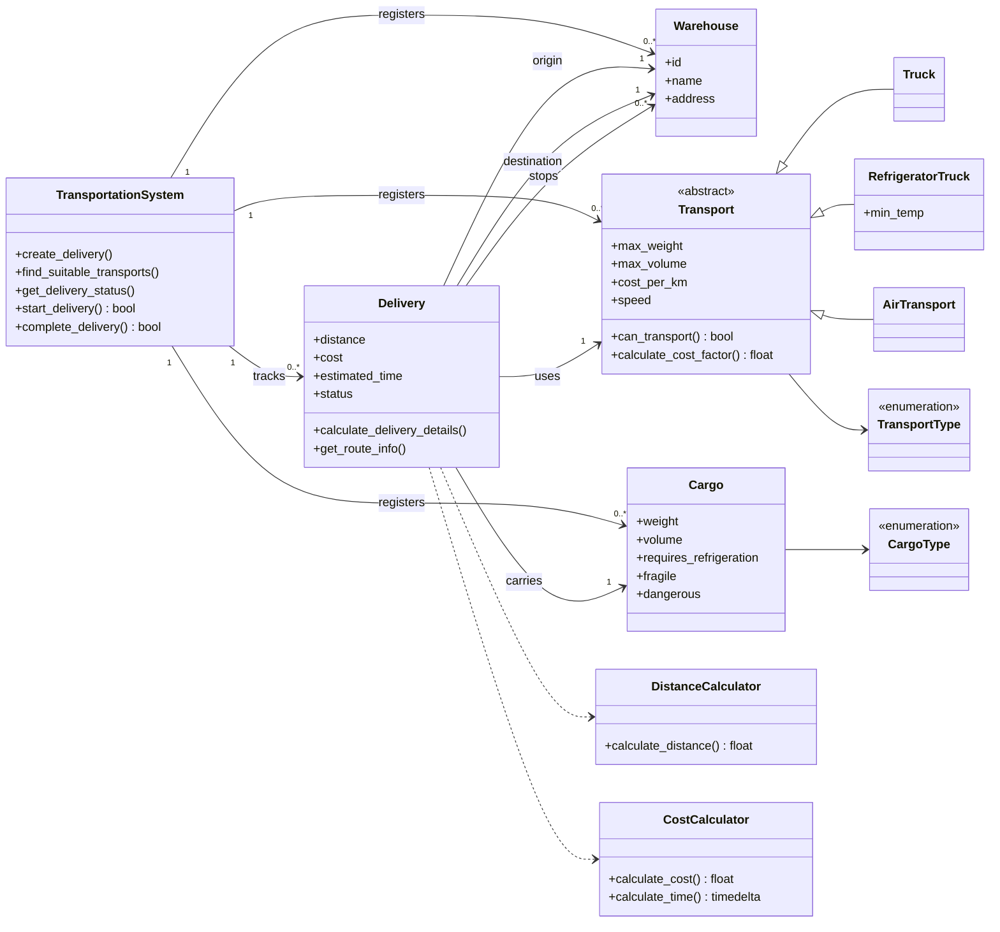

# Lesson 3: Cargo delivery in Python

This exercise models cargo delivery between warehouses. A delivery can go
straight to its destination or stop at intermediate warehouses. Each vehicle
type defines which cargo it can carry and how the cargo affects its rate.

## Run the example

From the repository root, run the script with Python 3. It uses the standard
library.

```bash
python3 lesson_3/dz.py
```

The example sends electronics from Gomel to Minsk and frozen goods along a
route that stops in Brest. It prints the distance, cost, and estimated travel
time for each delivery, then starts the first one.

## Class diagram



## How a delivery works

1. The system looks up the cargo, vehicle, and warehouses by ID. An unknown
   warehouse ID or an incompatible vehicle prevents the delivery from being
   registered.
2. The delivery keeps one simulated distance for its route. The cost, travel
   time, and printed distance all use that value. The time estimate includes
   one hour for handling.
3. A delivery starts as `pending`, moves to `in_transit` when it departs, and
   becomes `delivered` when it arrives. An invalid or repeated transition
   returns `False` and preserves the recorded timestamps.
